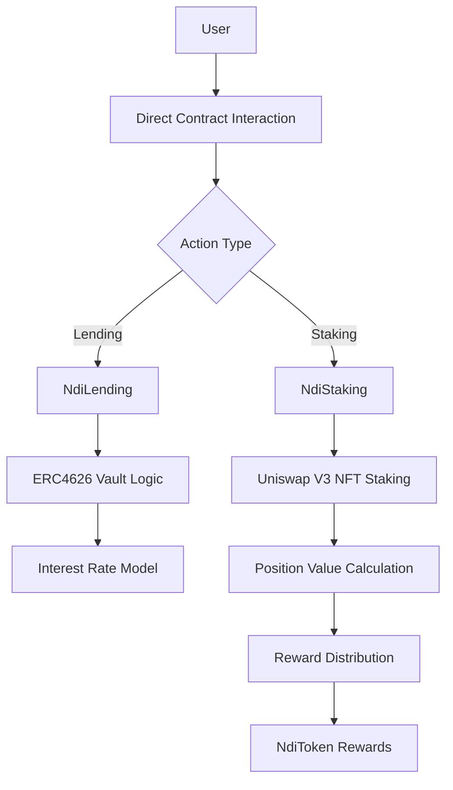

# Ndi-Fi

**Ndi-Fi** is a decentralized finance (DeFi) protocol for **lending and staking** on Ethereum and compatible chains. This repository contains all smart contracts, tests, deployment scripts, and protocol documentation for the project under the **Ndi-Fi** organization.

---

## 🚀 **Table of Contents**

- [About Ndi-Fi](#about-ndi-fi)
- [Folder Structure](#folder-structure)
- [Contributor Onboarding](#-contributor-onboarding)
- [Getting Started](#getting-started)
- [Docker Compose](#docker-compose)
- [Development Workflow](#development-workflow)
- [Testing](#testing)
- [Deployment](#deployment)
- [Branching Strategy](#branching-strategy)
- [Contributing](#contributing)
- [License](#license)

### 📖 Key Documentation

| Document | Description |
|---|---|
| [docs/DIAGRAMS.md](./docs/DIAGRAMS.md) | Mermaid sequence and flow diagrams for every core protocol operation |
| [docs/ERROR_CATALOGUE.md](./docs/ERROR_CATALOGUE.md) | Complete error reference for Solidity and Soroban contracts, with frontend mapping |
| [MarketAnalysis.md](./MarketAnalysis.md) | Competitive landscape, SWOT, and contributor positioning note |
| [Roadmap.md](./Roadmap.md) | Phase-by-phase milestone plan |
| [docs/stellar/ARCHITECTURE.md](./docs/stellar/ARCHITECTURE.md) | Stellar/Soroban contract architecture |

---

## 🔗 **About Ndi-Fi**

Ndi-Fi provides secure and transparent lending and staking services using upgradeable smart contracts, ensuring flexibility and future-proofing protocol logic.

---

## 🗂️ **Folder Structure (MVP)**

```
Ndi-Fi/
├── src/                               # Smart contract source code (Foundry structure)
│   ├── core/                          # Core protocol contracts
│   │   ├── NdiLending.sol           # Main lending vault (ERC4626-based)
│   │   ├── NdiStaking.sol           # Uniswap V3 NFT staking vault
│   │   └── NdiInterestRate.sol      # Simple interest rate model
│   ├── interfaces/                    # Contract interfaces
│   │   ├── INdiLending.sol          
│   │   ├── INdiStaking.sol          
│   │   └── IUniswapV3Pool.sol         # Minimal Uniswap V3 interface
│   ├── libraries/                     # Utility libraries
│   │   ├── SafeMath.sol               # Mathematical operations
│   │   └── UniswapV3Utils.sol         # Uniswap V3 position utilities
│   ├── tokens/                        # Token contracts
│   │   ├── NdiToken.sol             # Protocol governance/reward token
│   │   └── nzETH.sol                  # Single wrapped lending token (MVP)
│   └── mocks/                         # Mock contracts for testing
│       ├── MockERC20.sol              
│       └── MockUniswapV3Pool.sol      
├── script/                            # Deployment scripts (Foundry)
│   ├── Deploy.s.sol                   # Main deployment script
│   └── SetupProtocol.s.sol            # Protocol initialization
├── frontend/                          # Accessible, localized DeFi help UI
│   ├── src/                           # Tooltip/inline-help components + locales
│   └── test/                          # Dependency-free component/content tests
├── web/                               # Framework-agnostic shared UI pieces
│   ├── components/footer/             # Shared footer component + config
│   └── components/data-table/         # Responsive positions/history tables
├── test/                              # Test suites (Foundry)
│   ├── NdiLending.t.sol             # Lending tests
│   ├── NdiStaking.t.sol             # Staking tests
│   ├── Integration.t.sol              # Integration tests
│   └── helpers/                       # Test utilities
│       └── TestSetup.sol              
├── docs/                              # Documentation
│   ├── MVP-Overview.md                # MVP feature overview
│   ├── Lending-Guide.md               # How to use lending
│   ├── Staking-Guide.md               # How to stake NFTs
│   └── Architecture.md                # Technical architecture
├── foundry.toml                       # Foundry configuration
├── remappings.txt                     # Import path mappings
├── .env.example                       # Environment variables template
├── .gitignore                         
└── README.md                          
```

---

## 🎯 **MVP Features**

### **Core Functionality**
- **ETH Lending Only**: Single asset lending pool using ERC4626 standard
- **Uniswap V3 NFT Staking**: Direct NFT position staking (no LP tokens)
- **Simple Interest Model**: Basic fixed-rate interest calculation
- **Reward Distribution**: NdiToken rewards for stakers

### **MVP Limitations**
- Single asset (ETH) for lending
- No multi-asset support
- No liquidation mechanism
- No governance (admin-controlled)
- No price oracles
- Basic reward calculation

### **Future Expansions**
- Multi-asset lending (USDC, WBTC)
- Risk management & liquidations
- Governance token functionality
- Advanced yield strategies
- Cross-chain compatibility

---

## 🏗️ **Protocol Flow Architecture**

### **1. Core Protocol Flow**



### **2. Lending Protocol Architecture**

```
┌─────────────────┐    ┌─────────────────┐    ┌─────────────────┐
│   User Wallet   │    │   ndETH Token   │    │   ETH Asset     │
│                 │◄──►│  (ERC4626)      │◄──►│                 │
└─────────────────┘    └─────────────────┘    └─────────────────┘
         │                       │                       │
         │                       │                       │
         ▼                       ▼                       ▼
┌─────────────────────────────────────────────────────────────────┐
│                    Ndi-Lending (ERC4626)                       │
│  ┌─────────────┐  ┌─────────────┐  ┌─────────────────────────┐  │
│  │   Deposit   │  │  Withdraw   │  │    Interest Rate        │  │
│  │   Logic     │  │   Logic     │  │      Model              │  │
│  └─────────────┘  └─────────────┘  └─────────────────────────┘  │
└─────────────────────────────────────────────────────────────────┘
```

### **3. Staking Protocol Architecture (Uniswap V3 NFTs)**

```
┌─────────────────┐    ┌─────────────────┐    ┌─────────────────┐
│ Uniswap V3 NFT  │    │ Staking Vault   │    │ Reward Pool     │
│   Positions     │◄──►│                 │◄──►│ (NdiToken)    │
└─────────────────┘    └─────────────────┘    └─────────────────┘
         │                       │                       │
         ▼                       ▼                       ▼
┌─────────────────────────────────────────────────────────────────┐
│                    NdiStaking                                 │
│  ┌─────────────┐  ┌─────────────┐  ┌─────────────────────────┐  │
│  │   Stake     │  │  Unstake    │  │   Position Value        │  │
│  │   NFT       │  │   NFT       │  │   Calculation           │  │
│  └─────────────┘  └─────────────┘  └─────────────────────────┘  │
└─────────────────────────────────────────────────────────────────┘
         │                       │                       │
         ▼                       ▼                       ▼
┌─────────────────┐    ┌─────────────────┐    ┌─────────────────┐
│ Uniswap V3      │    │   Time-based    │    │   Emergency     │
│ Integration     │    │   Rewards       │    │   Functions     │
└─────────────────┘    └─────────────────┘    └─────────────────┘
```

### **4. MVP Integration Layer**

```
┌─────────────────────────────────────────────────────────────────┐
│                      External Integrations                      │
├─────────────────────────────┬───────────────────────────────────┤
│        Uniswap V3           │         OpenZeppelin              │
│  ┌─────────────────────┐    │  ┌─────────────────────────────┐  │
│  │  NFT Position       │    │  │    ERC4626 Standard         │  │
│  │  Manager            │    │  │    Access Control           │  │
│  │  Pool Interaction   │    │  │    Security Features        │  │
│  └─────────────────────┘    │  └─────────────────────────────┘  │
└─────────────────────────────┴───────────────────────────────────┘
```

---

## � **Docker Compose**

Run the full local stack (Foundry, Stellar Soroban, and Web) with Docker Compose:

### Prerequisites

- Docker and Docker Compose installed
- Copy `.env.example` to `.env` and configure as needed

### Quick Start

```bash
# Copy environment variables
cp .env.example .env

# Start all services
docker-compose up -d

# View logs
docker-compose logs -f

# Stop all services
docker-compose down
```

### Services

- **Foundry** (port 8545): Ethereum local node with Anvil for Solidity contract development
- **Stellar** (port 8000): Stellar Soroban local network for Rust contract development
- **Web** (port 3000): Web application frontend (placeholder - configure your web app in docker-compose.yml)

### Healthchecks

Each service includes healthchecks to ensure they are ready before dependent services start. The web service waits for both Foundry and Stellar to be healthy.

### Environment Variables

All services share environment variables via `.env` file. See `.env.example` for available variables.

---

## �🔄 **Development Workflow**

1. **Local Development**: `contracts/`, `test/`, `scripts/`
2. **Docker Compose**: `docker-compose up -d --build` (runs Anvil backend & frontend help UI with `env_file: .env`)
3. **Testing**: Unit → Integration → E2E testing
4. **Deployment**: Testnet → Mainnet via `scripts/deploy/`
5. **Monitoring**: Protocol metrics and security monitoring
6. **Upgrades**: Managed through proxy contracts and governance

---

## 🛡️ **Security Architecture**

- **Upgradeable Contracts**: OpenZeppelin proxy pattern
- **Access Control**: Role-based permissions
- **Emergency Functions**: Pause mechanism and emergency withdrawals
- **Audit Trail**: Comprehensive event logging
- **Price Oracle**: Chainlink integration for secure price feeds

---

## 📚 **Security & Protocol Documentation**

| Document | What it covers |
|---|---|
| [`docs/LOCAL_STACK.md`](docs/LOCAL_STACK.md) | Running the full local stack: anvil (EVM), Stellar/Soroban tests, frontend demo, web UI — ports, env vars, `dev-local.sh` script, and cross-stack troubleshooting |
| [`docs/ONBOARDING.md`](docs/ONBOARDING.md) | Contributor onboarding guide: step-by-step setup, starter task progression ladder, curated good first issues, Wave template guide, mentorship SLA |
| [`docs/ORACLE.md`](docs/ORACLE.md) | Price feed / oracle configuration: Chainlink feeds per collateral, staleness/deviation/fallback status, and how to add a new collateral feed |
| [`docs/UPGRADEABILITY.md`](docs/UPGRADEABILITY.md) | Upgradeability and admin model across the Solidity and Stellar contracts, governance roadmap, upgrade verification, key management |
| [`docs/VAULT_ERC4626.md`](docs/VAULT_ERC4626.md) | NdiFiVault ERC-4626 conformance, deviations, fees/rounding, slippage limits, property tests, asset recovery |
| [`docs/AUDIT_READINESS.md`](docs/AUDIT_READINESS.md) | Repeatable audit-readiness checklist: tests, invariants, static analysis, known issues, auditor scope template |
| [`docs/SOLIDITY_API.md`](docs/SOLIDITY_API.md) | Auto-generated Solidity contract API reference: local `forge doc` workflow and link to the published docs site |

The browsable contract reference is built from NatSpec comments by
[`forge doc`](https://getfoundry.sh/config/reference/doc-generator/) and published to
GitHub Pages by the [Docs workflow](.github/workflows/docs.yml). Generated output
lives in `docs/reference/solidity/` and is intentionally excluded from Git.

---


## Stellar (Soroban)

Ndi-Fi also has a Stellar implementation written in Rust for
[Soroban](https://developers.stellar.org/docs/build/smart-contracts/overview).
It lives in [`stellar/`](stellar/) and runs alongside the Solidity contracts,
which are unchanged.

- **NdiToken**: SEP-41 reward token (NDI) on OpenZeppelin Stellar Contracts.
- **NdiLending**: vault over any SEP-41 asset (XLM or USDC). One owner-approved borrower pays a fixed APR, which raises the share price for depositors.
- **NdiStaking**: stake an LP token, earn NDI, unstake after a cooldown, or emergency-withdraw anytime.

Build and test:

```bash
cd stellar
cargo test
stellar contract build
```

Setup, deployment and design notes: [`stellar/README.md`](stellar/README.md),
[`docs/stellar/ARCHITECTURE.md`](docs/stellar/ARCHITECTURE.md) and
[`docs/stellar/MIGRATION.md`](docs/stellar/MIGRATION.md).
Contract API reference (public functions, events, error codes): [`docs/stellar/API_REFERENCE.md`](docs/stellar/API_REFERENCE.md).

## Frontend help UI

[`frontend/`](frontend/) holds a framework-agnostic tooltip and inline-help
system for DeFi concepts (collateral factor, APR, health factor and more),
with plain-language definitions, progressive disclosure and English/Spanish/
French copy. Run `cd frontend && npm test` or `npm run demo` for the live
examples. See [`frontend/README.md`](frontend/README.md) for details.

This project takes part in the
[Stellar Wave Program](https://www.drips.network/wave/stellar). See
[`docs/ONBOARDING.md`](docs/ONBOARDING.md) for curated first issues,
[`CONTRIBUTING.md`](CONTRIBUTING.md) for workflow rules,
[`docs/TESTING.md`](docs/TESTING.md) for the testing strategy (unit, fuzz, invariant, integration across all layers), and
[`DEVELOPMENT.md`](DEVELOPMENT.md) before picking up an issue.

> **Do not start work on an issue until a maintainer assigns it to you. Comment on the issue to express interest.**

## CI, deployments, and security

- **Pre-commit (local):** optional formatting/lint hooks (`forge fmt`, `cargo fmt`, Prettier, ESLint). See [DEVELOPMENT.md](DEVELOPMENT.md).
- **Solidity verification:** [`Verify Solidity Contracts`](.github/workflows/verify-solidity.yml) runs on tagged releases or manual dispatch (`forge verify-contract`, `ETHERSCAN_API_KEY` secret). Document verification status in release notes.
- **Stellar testnet deploy:** [`Deploy Stellar Contracts (Testnet)`](.github/workflows/deploy-stellar-testnet.yml) is manual-dispatch only, requires approval via the `stellar-testnet` environment, uploads `deployments/testnet.json` as an artifact, and posts a deploy summary comment.
- **Security:** see [SECURITY.md](SECURITY.md) for vulnerability reporting, secret scanning/push protection expectations, and dependency review policy.
- **Support:** see [SUPPORT.md](SUPPORT.md) for documentation links and how to reach the maintainers.

## Reusable UI

The shared, framework-agnostic footer lives in
[`web/components/footer`](web/components/footer/README.md). It provides grouped
links (docs, security, governance and support), a risk disclosure, a
version/network indicator, and a mobile collapse. Preview it with
`cd web && python3 -m http.server 8000`.

## Frontend environment

Copy `.env.example` to `web/.env.local` and set the public mainnet and Sepolia
chain IDs, RPC URLs, and deployed contract addresses. The `NEXT_PUBLIC_*`
prefix means values are exposed in browser bundles: use public RPC endpoints
and never place private keys or other secrets in these variables. This
repository does not include deployed EVM contract addresses, so populate the
address entries from the deployment you intend to use.

Validate the configuration before building with `cd web && npm run
validate:env`. A Next.js build also validates it through `web/next.config.js`.
Use `web/config/contract-registry.js` to resolve a contract by connected
chain ID (`getConnectedChainAddresses` reads `eth_chainId` from an EIP-1193
wallet provider). Unsupported chains and unknown contract names fail with
explicit errors rather than falling back to another deployment.

Privacy-respecting event tracking is provided by
[`web/analytics`](web/analytics/README.md). Events are disabled unless users
opt in; the documented taxonomy and property allowlist exclude wallet and
transaction identifiers.

Use [`web/config/explorer.js`](web/config/explorer.js) for mainnet and Sepolia
address, token, and transaction links. `createExplorerLink` centralizes safe
new-tab attributes (`rel="noopener noreferrer"`); this repository currently
has no transaction UI to update directly.
