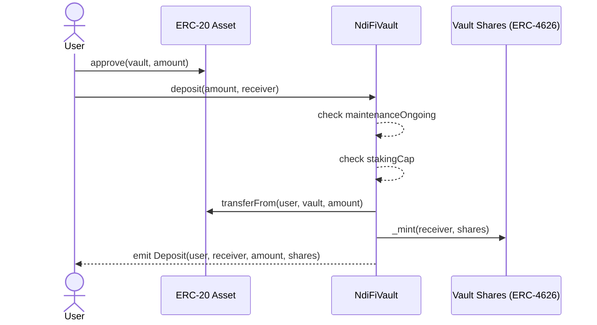
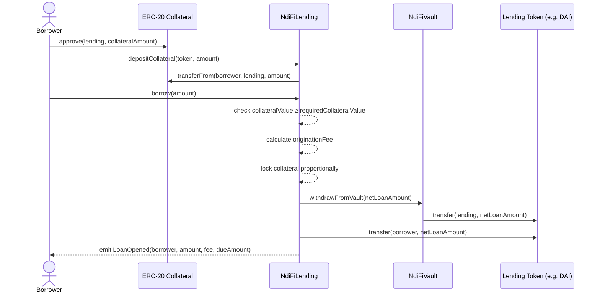
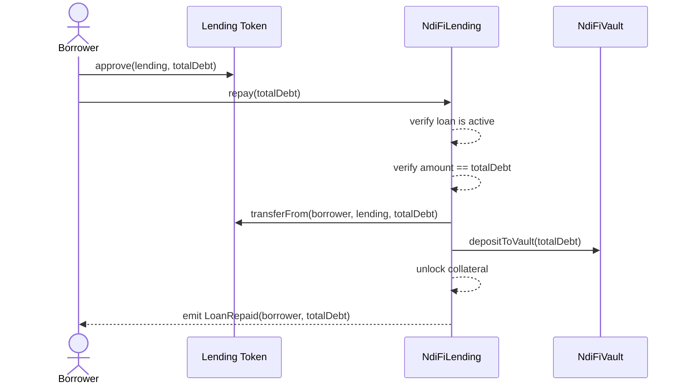
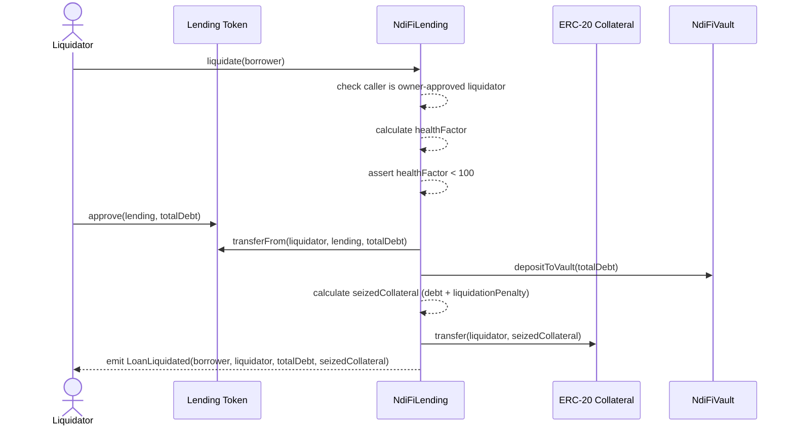
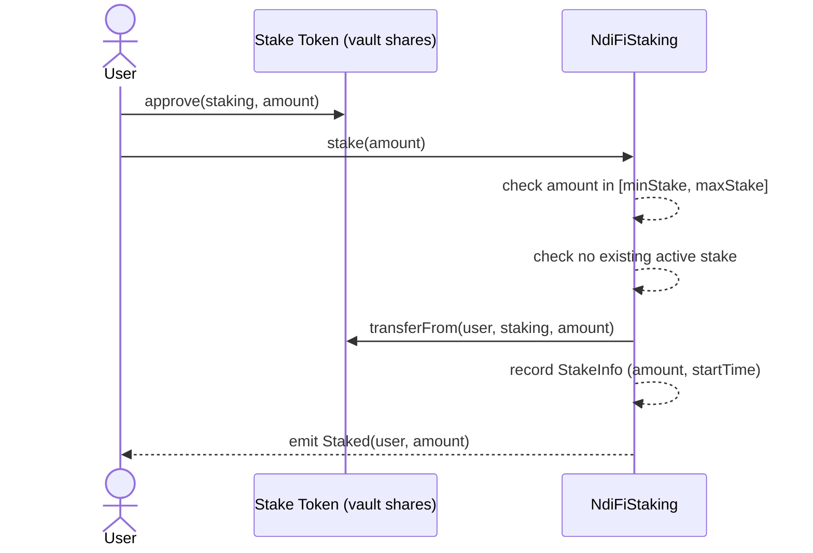
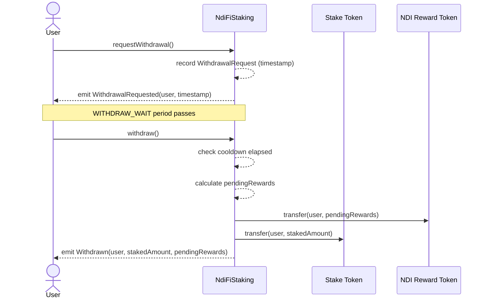
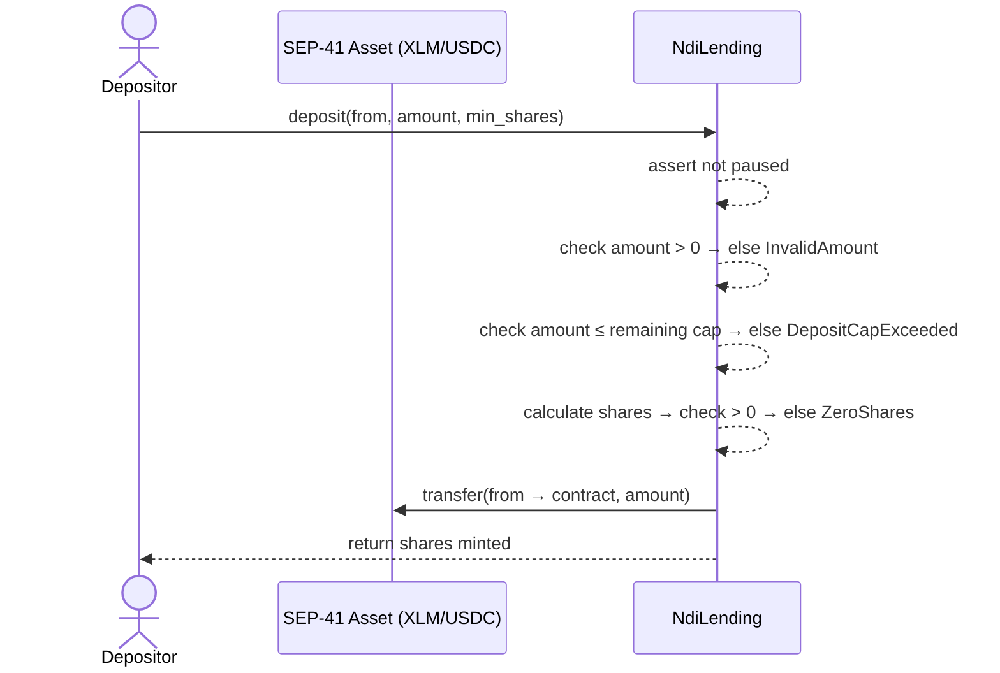
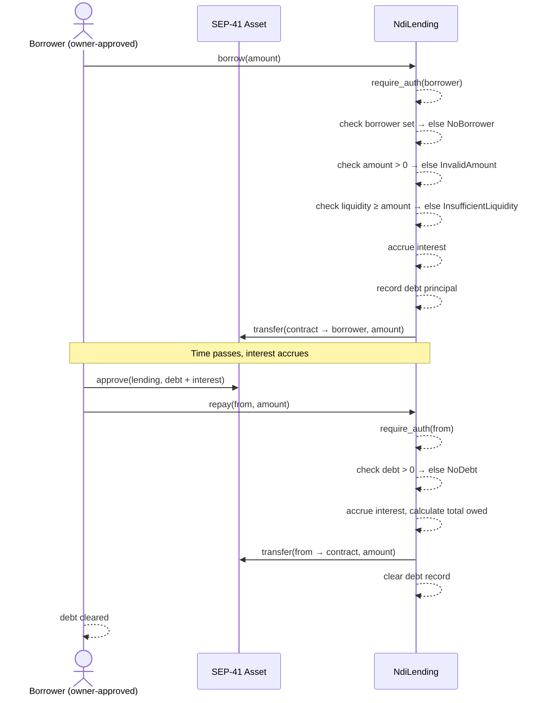
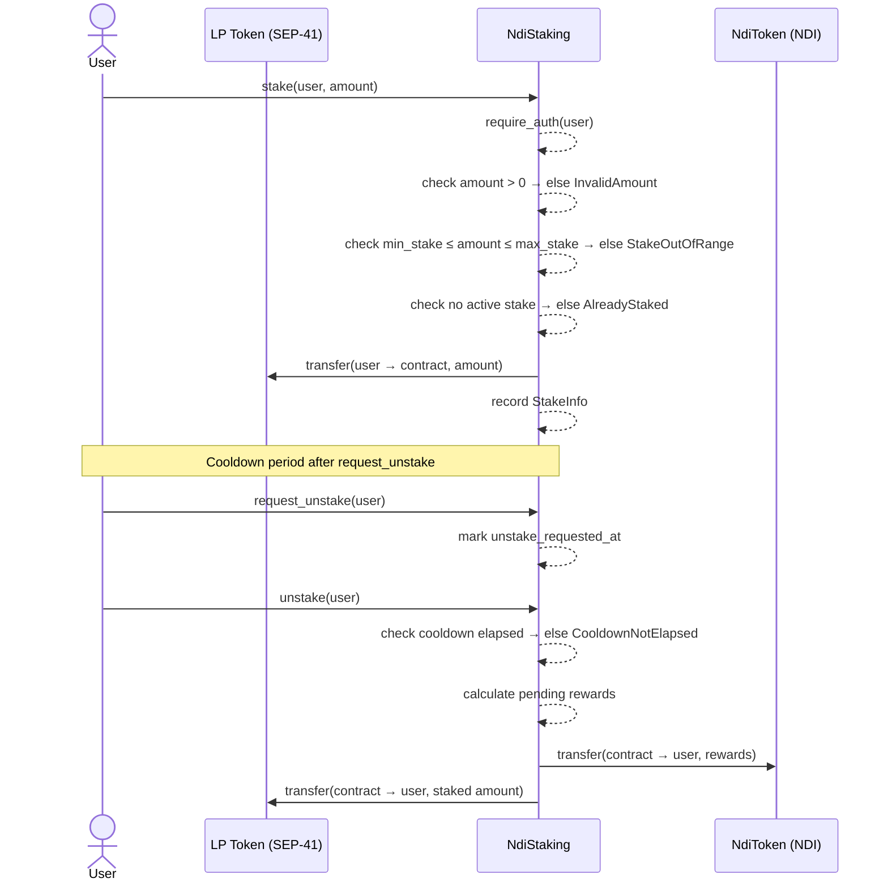
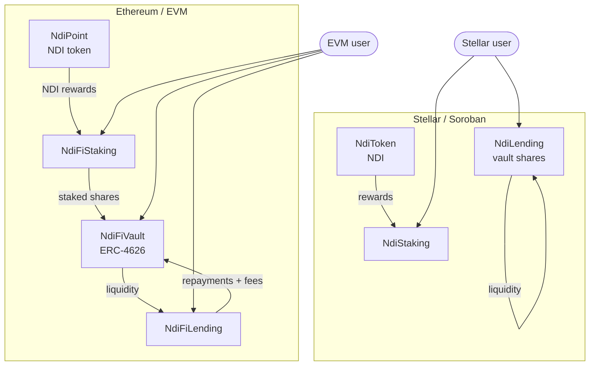

# Core Flow Diagrams

This document contains Mermaid sequence and flow diagrams for the key operations in the Ndi-Fi protocol. All diagrams are kept in source form so they stay in sync with contract changes and render natively in GitHub, Docusaurus, and most modern Markdown viewers.

> **Keeping diagrams up to date:** When a contract changes a flow (new guard, new event, changed actor), update the corresponding diagram in the same PR. Diagrams that drift from contract behavior are more harmful than no diagrams.

---

## 1. Deposit into NdiFiVault / NdiLending (Solidity)

A user deposits an ERC-20 asset into the vault and receives vault shares in return.

---

## 2. Borrow (NdiFiLending — Solidity)

A borrower posts collateral and draws a loan from the vault's available liquidity.

---

## 3. Repay loan (NdiFiLending — Solidity)

The borrower repays the full outstanding debt to unlock their collateral.

---

## 4. Liquidation (NdiFiLending — Solidity)

When a borrower's health factor drops below 100, an authorised liquidator can repay their debt and seize collateral at a discount.

---

## 5. Stake (NdiFiStaking — Solidity)

A user deposits vault shares to start earning NDI rewards.

---

## 6. Unstake with cooldown (NdiFiStaking — Solidity)

Unstaking is a two-step process: request then withdraw after the cooldown.

---

## 7. Lending vault deposit (Stellar / Soroban)

---

## 8. Borrow and repay (Stellar / Soroban)

---

## 9. Staking on Stellar

---

## 10. High-level protocol overview

---

*Diagrams are written in [Mermaid](https://mermaid.js.org/) syntax. To render them locally, use the [Mermaid Live Editor](https://mermaid.live/) or any Markdown renderer with Mermaid support.*
