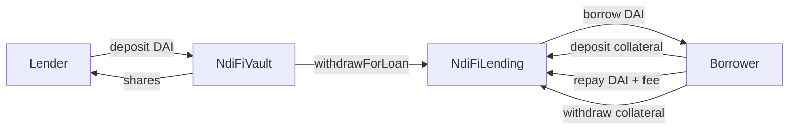

# Ndi-Fi Lending Guide

This guide walks you through using the Ndi-Fi lending market: depositing
collateral, borrowing, monitoring your position, repaying, and withdrawing
collateral. It also explains collateral factor, health factor and liquidation in
plain language.

> **Scope.** This guide describes the Solidity contracts in `src/`:
> [`NdiFiLending.sol`](../src/NdiFiLending.sol) and
> [`NdiFiVault.sol`](../src/NdiFiVault.sol). The separate Stellar/Soroban
> `NdiLending` contract is a fixed-rate vault without collateral or liquidation;
> see [`stellar/README.md`](../stellar/README.md) if you are using that
> deployment.

---

## Contents

- [Before you start](#before-you-start)
- [How the market works](#how-the-market-works)
  - [Collateral factor](#collateral-factor)
  - [Liquidation threshold](#liquidation-threshold)
  - [Health factor](#health-factor)
  - [Liquidation](#liquidation)
  - [Origination fee](#origination-fee)
- [Step-by-step: deposit, borrow, repay, withdraw](#step-by-step-deposit-borrow-repay-withdraw)
- [Worked example](#worked-example)
- [Monitoring your position](#monitoring-your-position)
- [Liquidation guide](#liquidation-guide)
- [UI reference](#ui-reference)
- [Troubleshooting](#troubleshooting)
- [Contract reference](#contract-reference)
- [Safety and known limitations](#safety-and-known-limitations)

---

## Before you start

You need:

1. **A wallet** on the network where Ndi-Fi is deployed.
2. **The lending token** (the asset the vault lends, e.g. DAI). You need it to
   repay a loan.
3. **A supported collateral token** and enough of it to cover the loan. The
   protocol owner decides which tokens are accepted and which Chainlink price
   feed prices each one. A token that is not on the owner's allow-list cannot be
   used as collateral.
4. **A small amount of the network's gas token** for transaction fees.
5. **Token approvals** for both the collateral token and the lending token,
   depending on the action:

   | Action | Approval needed |
   |---|---|
   | Deposit collateral | Collateral token -> `NdiFiLending` |
   | Repay loan | Lending token -> `NdiFiLending` |
   | Liquidate a loan | Lending token -> `NdiFiLending` |
   | Deposit into the vault (lender side) | Lending token -> `NdiFiVault` |

Ask the protocol team for the deployed addresses of `NdiFiLending` and
`NdiFiVault` on your network. Addresses are deployment-specific and are not
hard-coded in this repository.

> **Network check.** Collateral values come from Chainlink feeds configured for
> a specific chain. Using the wrong network or a stale feed address makes every
> value in the UI wrong. Always confirm the chain ID and the two contract
> addresses before signing.

---

## How the market works

Ndi-Fi separates two roles:

- **Lenders** deposit the lending token (e.g. DAI) into `NdiFiVault`, an
  ERC-4626 vault, and receive vault shares.
- **Borrowers** lock collateral in `NdiFiLending`, then borrow the lending token
  from the vault. The borrower repays principal plus a one-time origination fee.

The vault must authorize the lending contract before loans can be drawn. This is
an owner-only setup step (`setAuthorizedLendingContract`), not something users
do.



### Collateral factor

The **collateral factor** is the percentage of your collateral's USD value that
you are allowed to borrow against.

Example: with a 75% collateral factor and $2,000 of collateral, your maximum
borrowing power is $1,500.

The factor is set by the owner at initialization and can be changed later, as
long as it stays below the liquidation threshold. A higher factor means more
borrowing power and less safety margin.

`collateralFactor` is stored as a whole percentage: `75` means 75%.

### Liquidation threshold

The **liquidation threshold** is the percentage of collateral value at which
your loan becomes unsafe. It is always greater than the collateral factor.

Example: with an 85% liquidation threshold, a $2,000 collateral position
supports $1,700 of debt before liquidation becomes possible.

The gap between the two values (75% -> 85% in this example) is the buffer
between "you cannot borrow more" and "you can be liquidated".

`liquidationThreshold` is stored as a whole percentage: `85` means 85%.

### Health factor

The health factor summarizes how close a loan is to liquidation. Ndi-Fi reports
it as a percentage:

```
health factor = (collateral value x liquidation threshold / 100) / loan value x 100
```

Where `loan value` is the USD value of the loan principal. (The origination fee
is added to the repayment amount, but the health-factor calculation prices the
principal only.)

| Health factor | Meaning |
|---|---|
| `> 100` | Safe. The loan is above the liquidation threshold. |
| `= 100` | Exactly at the threshold. It is **not** liquidatable yet. |
| `< 100` | Liquidatable. An authorized liquidator may repay the debt and seize collateral. |
| `type(uint256).max` | You have no active loan. |

The contract returns whole-percent integer math, so a value of `170` means 170%,
not 1.70. Values truncate; do not rely on a displayed value of `100` to mean
there is meaningful headroom.

### Liquidation

A loan becomes liquidatable when its health factor drops below `100`. This can
happen because:

- the collateral price falls, or
- the loan is close to the maximum borrowing power when taken.

Liquidation is **owner-only** in this version: the contract's `onlyLiquidator`
modifier requires the caller to be the owner. A liquidator:

1. Repays the borrower's full debt (principal + origination fee) in the lending
   token.
2. Receives collateral worth the debt value **plus a liquidation penalty**.
   The penalty is paid in collateral and is capped at 20%
   (`liquidationPenalty` is in basis points; `500` = 5%).
3. The borrower's loan is closed.

Collateral is seized starting with the highest-value supported token and
continues until the debt plus penalty is covered. If the position is
under-collateralized, all available collateral can be seized.

Borrowers should repay or add collateral before the health factor crosses
`100`. There is no partial-repayment path: repayment must clear the whole debt.

### Origination fee

The **origination fee** is charged once when the loan is taken. It is set in
basis points and capped at 10% (`1000` basis points).

Read the following carefully, because the arithmetic is not the usual
"fee deducted from principal":

- Requested loan amount: `amount`
- Origination fee: `amount x originationFeeRate / 10000`
- Amount actually sent to the borrower: `amount - fee`
- Total debt recorded and required at repayment: `amount + fee`

In other words, the requested amount is treated as the principal and the fee is
added **on top** of it, while the fee is also withheld from the disbursement.
Budget for a total cost of roughly twice the fee on the requested amount. The
exact amount is always available from `getLoanDetails(user).totalDebt`; repay
that value.

There is **no time-based interest** in this Solidity version. The origination
fee is the only cost of borrowing.

---

## Step-by-step: deposit, borrow, repay, withdraw

The steps below are written for a wallet or block explorer. If you use a web
front end, the button names may differ; the function names and order are the
same.

### 1. Approve the collateral token

Call `approve(spender = NdiFiLending, amount)` on the collateral ERC-20. Start
with the amount you plan to deposit, not an unlimited approval, unless you
trust the deployment.

### 2. Deposit collateral

Call:

```solidity
NdiFiLending.depositCollateral(address token, uint256 amount)
```

- `token` must be a supported collateral token.
- `amount` must be greater than zero.
- The contract transfers the tokens into itself and credits
  `collateralBalances[you][token]`.

After this call, `getCollateralValue(you)` returns your total collateral value
in USD with 18 decimals (using the Chainlink feeds). The deposit also increases
`getContractStats().totalCollateralAmount`, which is a raw sum of token units
across all supported collateral tokens, not a USD value.

You do not have to borrow immediately. Deposited collateral stays in the
contract until you withdraw it.

### 3. Take a loan

Call:

```solidity
NdiFiLending.takeLoan(uint256 amount)
```

- `amount` is the requested loan size in lending-token units.
- You must have deposited collateral first.
- You can have only one active loan at a time. Repay the current loan before
  taking another.
- The vault must hold enough idle lending tokens; otherwise the call reverts
  with `Insufficient vault liquidity`.
- The contract checks that the requested value is within
  `collateral value x collateralFactor / 100`.
- It then locks enough of your collateral to cover the loan and transfers
  `amount - originationFee` to you.

The loan is recorded with the full requested amount as principal. Check the
result with `getLoanDetails(you)`:

| Field | Meaning |
|---|---|
| `principal` | The requested loan amount. |
| `originationFee` | One-time fee added to the debt. |
| `totalDebt` | `principal + originationFee`; repay exactly this. |
| `collateralAmount` | Raw units of collateral locked for this loan. |
| `healthFactor` | Current health factor percentage. |
| `isActive` | Whether the loan is open. |

### 4. Monitor the position

While the loan is open, watch:

- `calculateHealthFactor(you)` — keep it comfortably above `100`.
- the collateral price feed for your token;
- `getAvailableLiquidity()` on the vault if you are a lender.

If the health factor approaches `100`, repay the loan or deposit more
collateral.

### 5. Repay the loan

Call `approve(spender = NdiFiLending, amount = totalDebt)` on the lending token,
then:

```solidity
NdiFiLending.repayLoan(uint256 amount)
```

`amount` must equal `principal + originationFee` **exactly**. The contract
rejects partial repayment and overpayment with `Must repay full debt amount`.

On success:

- the loan is marked inactive,
- `totalBorrowed` decreases,
- all of your locked collateral for that loan is unlocked,
- the lending tokens remain in the `NdiFiLending` contract (see
  [Safety and known limitations](#safety-and-known-limitations)).

Use `getLoanDetails(you)` first to read `totalDebt`; do not calculate it from a
rounded UI display.

### 6. Withdraw collateral

After the loan is closed, call:

```solidity
NdiFiLending.withdrawCollateral(address token, uint256 amount)
```

You can withdraw up to your unlocked balance. While a loan is active, only the
portion of collateral not locked for that loan is withdrawable; trying to
withdraw locked collateral reverts with
`Cannot withdraw collateral locked for loan`.

Withdrawing collateral can lower your health factor. If a loan is still open,
check `calculateHealthFactor` before and after.

---

## Worked example

Assumptions:

- Collateral: 1 WETH priced at $2,000.
- Lending token: DAI at $1.00.
- Collateral factor: 75%.
- Liquidation threshold: 85%.
- Origination fee: 1% (`100` basis points).
- Liquidation penalty: 5% (`500` basis points).

1. **Deposit 1 WETH.** Collateral value = $2,000.
2. **Borrow 1,000 DAI.**
   - Maximum borrowing power = $2,000 x 75% = $1,500. The loan fits.
   - Origination fee = 1,000 x 1% = 10 DAI.
   - You receive 990 DAI.
   - Total debt = 1,000 + 10 = 1,010 DAI.
   - Required collateral value = 1,000 / 75% = $1,333.33, so about 0.6667 WETH
     is locked and about 0.3333 WETH remains withdrawable.
3. **Health factor after borrowing** =
   ($2,000 x 85% / 100) / $1,000 x 100 = **170**.
4. **WETH falls to $1,100.**
   - Health factor = ($1,100 x 85% / 100) / $1,000 x 100 = **93.5**.
   - The loan is now liquidatable.
5. **Liquidation.** A liquidator repays 1,010 DAI and is owed 1,010 + 5% =
   $1,060.50 of collateral, which is about 0.9641 WETH at $1,100.

The numbers above are illustrative. The deployed contract's `collateralFactor`,
`liquidationThreshold`, `originationFeeRate` and `liquidationPenalty` are the
source of truth.

---

## Monitoring your position

Useful read-only calls:

| Call | Returns |
|---|---|
| `getCollateralValue(user)` | Total USD value of the user's collateral, 18 decimals. |
| `collateralBalances(user, token)` | Raw token units deposited by the user. |
| `lockedCollateral(user, token)` | Raw token units currently locked for a loan. |
| `loans(user)` | Raw `Loan` struct for the user. |
| `getLoanDetails(user)` | Principal, fee, total debt, locked amount, health factor, active flag. |
| `getLoanValue(user)` | USD value of the loan principal. |
| `calculateHealthFactor(user)` | Health factor percentage (`max uint256` if no active loan). |
| `getContractStats()` | Total collateral, total borrowed, available vault liquidity, utilization. |
| `vault.getAvailableLiquidity()` | Idle lending tokens available to borrow. |

A healthy position has a health factor well above `100` and leaves room for
collateral price volatility. Because the health factor uses integer math and
prices can move between blocks, do not operate at the edge of the limit.

---

## Liquidation guide

Liquidation is restricted to the contract owner (`onlyLiquidator`). If you are
not the owner, `liquidateLoan` reverts with `Not authorized liquidator`.

Before liquidating:

1. Confirm the borrower's health factor is below `100`:
   `calculateHealthFactor(borrower)`.
2. Read the debt: `getLoanDetails(borrower).totalDebt`.
3. Approve that amount of the lending token to `NdiFiLending`.
4. Call `liquidateLoan(borrower)`.

The liquidator must hold the full debt amount. The call:

- transfers the debt from the liquidator to the lending contract,
- seizes collateral worth `debt value + liquidation penalty`, highest-value
  token first,
- marks the loan inactive.

If the health factor is `100` or higher, the call reverts with
`Loan is not liquidatable`. If the borrower has no active loan, it reverts with
`No active loan`.

Liquidation is not blocked by the pause flag. Repayment **is** blocked while the
market is paused, so a pause also prevents borrowers from reducing risk.

---

## UI reference

The repository does not ship a front end, and this guide intentionally does not
include screenshots that could go stale. If you are using the Ndi-Fi web app or
another interface, use these mappings to verify that what you see matches the
contract:

| UI concept | Contract source |
|---|---|
| "Supplied / Deposited" collateral | `collateralBalances(user, token)` |
| "Available to withdraw" | `collateralBalances - lockedCollateral` |
| "Borrowing power" | `getCollateralValue(user) x collateralFactor / 100` |
| "Total debt" | `getLoanDetails(user).totalDebt` |
| "Health factor" | `calculateHealthFactor(user)`; display as a percentage |
| "Liquidation threshold" | `liquidationThreshold` |
| "Origination fee" | `originationFeeRate` basis points |
| "Liquidation penalty" | `liquidationPenalty` basis points |

Always compare a UI value with a direct contract read before signing a
transaction, especially for repayment amounts and health factors. If a UI shows
a different token, network or contract address than the deployment you intend to
use, stop and verify the configuration.

---

## Troubleshooting

### The transaction reverts with `Contract not initialized`

The owner has not called `initialize` yet. Every user-facing function is gated
by `onlyInitialized`. Contact the protocol team; users cannot initialize it.

### `Token not supported`

The collateral token is not on the allow-list. Only the owner can add one with
`addCollateralToken(token, priceFeed)`. Do not send tokens directly to the
contract; they will not be credited.

### `No collateral deposited`

Deposit collateral with `depositCollateral` before calling `takeLoan`.

### `Loan exceeds collateral limit` or `Insufficient collateral for this loan`

The requested amount is larger than `collateral value x collateral factor`.
Lower the loan amount or deposit more collateral. Remember that the fee is added
to the debt, so leave headroom.

### `Existing loan must be repaid first`

Only one loan per address is supported. Repay the current loan in full, then take
a new one.

### `Insufficient vault liquidity`

The vault does not hold enough idle lending tokens. Lenders must deposit more,
or the protocol team must restore liquidity. Repayments are held by the lending
contract in this version rather than being returned to the vault.

### `Must repay full debt amount`

`repayLoan` requires the exact `principal + originationFee`. Read
`getLoanDetails(user).totalDebt` and approve/send that value. Partial repayment,
including paying only the principal, is rejected.

### `Cannot withdraw collateral locked for loan`

Part of your collateral is securing an active loan. Repay the loan first, or
withdraw only the unlocked amount shown by
`collateralBalances - lockedCollateral`.

### `Insufficient collateral`

You are trying to withdraw more than your recorded balance. Check the token
decimals and your `collateralBalances` value.

### `Loan is not liquidatable`

The health factor is at least `100`. Wait until it falls below `100`; a value of
exactly `100` is not enough.

### `Not authorized liquidator`

Only the contract owner can call `liquidateLoan`. Use the owner account or ask
the protocol team to liquidate.

### `EnforcedPause` / the market is paused

The owner has paused deposits, withdrawals, borrowing or repayment. Liquidation
still works. Wait for the owner to call `unpause`; do not send funds repeatedly.

### `ERC20: insufficient allowance` or `ERC20InsufficientAllowance`

Approve the exact token and spender before the action:

- collateral token -> `NdiFiLending` for `depositCollateral`;
- lending token -> `NdiFiLending` for `repayLoan`;
- lending token -> `NdiFiVault` for vault deposits.

If you changed an existing non-zero allowance, wallets may require setting it to
zero first.

### The health factor changed without a transaction

Collateral values are read from live Chainlink feeds. A price update changes
your health factor even when you do nothing. This is expected.

### A price read reverts

The configured feed address may be wrong for this network, or the feed may be
unavailable. Check the deployment configuration and the feed on the network's
Chainlink directory. The contract does not have a fallback oracle.

### `stakingCapExceeded` when depositing into the vault

The vault has a deposit cap (`stakingCap`). The owner can raise it with
`setStakingCap`. This is a lender-side vault limit, not a borrower limit.

### `OwnableUnauthorizedAccount`

The function is owner-only. Check that your wallet is the contract owner (or the
authorized lending contract for `withdrawForLoan`).

---

## Contract reference

### Borrower functions (`NdiFiLending`)

| Function | Who can call | Purpose |
|---|---|---|
| `depositCollateral(token, amount)` | Anyone | Deposit a supported token as collateral. |
| `withdrawCollateral(token, amount)` | Anyone | Withdraw unlocked collateral. |
| `takeLoan(amount)` | Anyone with collateral | Borrow against collateral. |
| `repayLoan(amount)` | Borrower | Repay the full debt. |
| `liquidateLoan(borrower)` | Owner only | Repay an unhealthy loan and seize collateral. |

### Read-only functions (`NdiFiLending`)

| Function | Purpose |
|---|---|
| `getCollateralValue(user)` | Collateral value in USD (18 decimals). |
| `getLoanValue(user)` | Loan principal value in USD (18 decimals). |
| `calculateHealthFactor(user)` | Health factor percentage, or max uint if no loan. |
| `getLoanDetails(user)` | Full loan summary. |
| `getContractStats()` | Protocol totals and vault liquidity. |
| `supportedCollateralTokens(token)` | Token address and Chainlink feed. |
| `collateralFactor()` | Current collateral factor (whole percent). |
| `liquidationThreshold()` | Current liquidation threshold (whole percent). |
| `originationFeeRate()` | Fee in basis points. |
| `liquidationPenalty()` | Penalty in basis points. |
| `paused()` | Whether user actions are paused. |
| `isInitialized()` | Whether the owner has initialized the market. |

### Vault functions (`NdiFiVault`)

| Function | Who can call | Purpose |
|---|---|---|
| `deposit(assets, receiver)` | Anyone | Deposit the lending token and receive shares. |
| `withdraw(assets, receiver, owner)` | Share owner | Withdraw a specific asset amount. |
| `mint(shares, receiver)` | Anyone | Mint an exact number of shares. |
| `redeem(shares, receiver, owner)` | Share owner | Redeem shares for assets. |
| `getAvailableLiquidity()` | Anyone | Idle lending tokens available to borrow. |
| `setAuthorizedLendingContract(address)` | Owner | Allow the lending contract to draw liquidity. |
| `setStakingCap(newCap)` | Owner | Change the deposit cap. |

---

## Safety and known limitations

Read these before using the market with meaningful funds:

- **Single loan per address.** There is no partial repayment, top-up or
  refinancing. Plan your repayment amount.
- **No time-based interest.** The only borrowing cost is the origination fee.
- **Owner-controlled risk parameters.** The owner sets the collateral factor,
  liquidation threshold, fee, penalty and supported tokens. These can change
  after you borrow.
- **Owner-only liquidation.** In this version there is no permissionless
  liquidation, so an unhealthy position may not be liquidated promptly.
- **Pausing blocks repayment.** The owner can pause deposits, withdrawals,
  borrowing and repayment. Liquidation stays enabled during a pause, so a
  paused market can leave a borrower unable to repay while still being
  liquidatable.
- **Chainlink dependency.** Values and liquidations depend on the configured
  feeds. The contract assumes 8-decimal feeds and has no staleness check or
  fallback oracle.
- **Vault liquidity.** Borrowed tokens leave the vault. Repayments stay in the
  lending contract in this version, so the vault's idle liquidity does not
  automatically recover when a loan is repaid. The protocol team must manage
  liquidity explicitly.
- **Not audited.** Treat this as an MVP. Use small amounts until the deployment
  has been independently reviewed.

For the engineering view of these limitations, see
[`docs/stellar/MIGRATION.md`](stellar/MIGRATION.md) §4 and the source comments.
