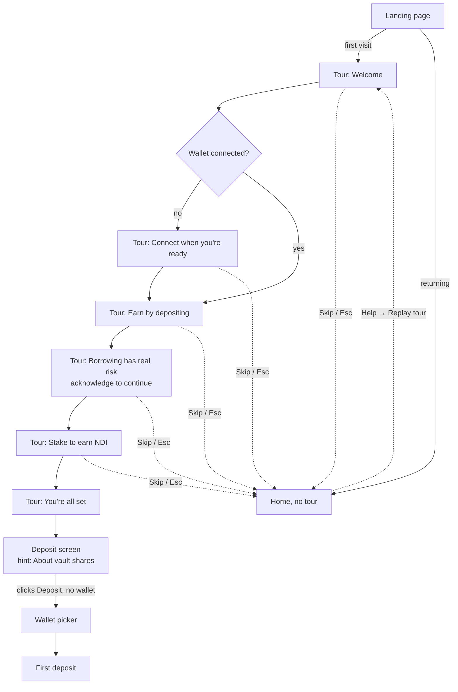

# 06 — Onboarding and first-run experience

> Issue #152 · Status: implemented in `web/components/onboarding/`

**Goal:** get a new visitor from landing to their first deposit with as little
friction as possible, without hiding the risks of borrowing.

## Principles

1. **Browse first, connect later.** Rates, pools and docs never need a wallet.
   Wallet connect shows up at the moment the user tries to act.
2. **Short and skippable.** Six steps at most, a visible *Skip tour* on every
   step but the last, and *Replay tour* in the Help menu.
3. **Teach risk before it can hurt.** The user must read and acknowledge how
   health factor and liquidation work before their first borrow.
4. **Teach in context.** One-time hints appear where they're relevant (the
   deposit form, the borrow form, a dropping health factor) instead of being
   front-loaded into the tour.
5. **Never re-tour a returning user.** Progress, skips and dismissed hints
   persist.

## First-run flow



## Tour steps

| # | Step | Points at | Content | Notes |
| --- | --- | --- | --- | --- |
| 1 | Welcome | — (centred) | What Ndi-Fi does; tour is 1 minute and can be replayed | |
| 2 | Connect when you're ready | `[data-tour="connect-wallet"]` | Explore without a wallet; connect to act | Only when no wallet is connected. Offers a **Connect wallet** button |
| 3 | Earn by depositing | `[data-tour="deposit"]` | Deposits earn interest as vault shares | |
| 4 | Borrowing has real risk | `[data-tour="borrow"]` | Health factor, liquidation below 1.00, penalty up to 20%, keep a buffer | **Next stays disabled until the user ticks "I understand…"** |
| 5 | Stake to earn NDI | `[data-tour="stake"]` | Staking earns NDI; unstaking has a cooldown | |
| 6 | You're all set | — (centred) | Start small; replay from Help | Button reads **Finish** |

If the wallet connects mid-tour, step 2 drops out and the user moves to the next
step. The step counter updates ("Step 2 of 5").

### Wireframe (desktop: anchored panel)

```
            ┌───────────────────────┐
            │  Deposit  ◄───────────┼── target gets a focus-ring outline
            └───────────────────────┘    and the page behind is dimmed
   ┌──────────────────────────────────────┐
   │ ⟱  STEP 3 OF 6                    ✕ │
   │ Earn by depositing                   │
   │ Deposit into the lending vault to    │
   │ earn interest. You receive vault     │
   │ shares that grow in value…           │
   │                                      │
   │ Skip tour            [Back] [ Next ] │
   └──────────────────────────────────────┘
```

### Wireframe (risk step)

```
   ┌──────────────────────────────────────┐
   │ ⛉  STEP 4 OF 6                    ✕ │
   │ Borrowing has real risk              │
   │ Borrowing lets you take a loan…      │
   │  • Health factor compares collateral │
   │    to debt. Above 1.00 is safe.      │
   │  • Below 1.00 you can be liquidated. │
   │  • Liquidation sells collateral plus │
   │    a penalty of up to 20%.           │
   │  • Borrow well below your limit.     │
   │ ┌──────────────────────────────────┐ │
   │ │ ☐ I understand how borrowing,    │ │
   │ │   health factor and liquidation  │ │
   │ │   work.                          │ │
   │ └──────────────────────────────────┘ │
   │ Skip tour            [Back] [ Next ]◄── disabled until ticked
   └──────────────────────────────────────┘
```

On screens narrower than 640px the panel docks to the bottom as a sheet, with
44px touch targets and safe-area padding.

## Wallet connect at the right moments

| Moment | Behaviour |
| --- | --- |
| Landing, browsing rates/pools/docs | No prompt. The header shows a quiet **Connect wallet** button |
| Tour step 2 | Explains connecting is optional until you act; offers the button |
| User presses Deposit / Borrow / Stake / Claim / Repay / Withdraw / Unstake / Liquidate without a wallet | `onboarding.walletPrompt(action)` returns `{ prompt: true }`. Open the wallet picker, then continue the action |
| Wallet connected, wrong network | `<ndi-error code="wrong-network">` with **Switch network** (see the [error states guide](../../web/components/error/README.md)) and the `wrong-network` hint |

## Risk education

- The tour's risk step needs an explicit acknowledgement. The time is stored as
  `riskAcknowledgedAt`.
- **Gate the first borrow:** before submitting a borrow, call
  `onboarding.canBorrow()`. If it returns `false`, open the tour at the risk
  step (or show the same content in the borrow form) instead of submitting.
  Users who skipped the tour still see it before they can be liquidated.
- The `borrow-health-factor` hint repeats the "aim above 1.5" advice on the
  borrow form. `health-factor-low` appears when the health factor drops below
  1.2.
- Numbers come from the contracts: health factor `100` = `1.00x`, liquidation
  penalty is capped at 2000 bps (20%) in `NdiFiLending`.

## Contextual hints

| Hint | Shown when | Content |
| --- | --- | --- |
| `deposit-shares` | First visit to the deposit form | Deposits become shares; withdraw any time subject to liquidity |
| `borrow-health-factor` | First visit to the borrow form | Keep health factor above 1.5 |
| `health-factor-low` | Health factor < 1.2 | Repay or add collateral |
| `stake-cooldown` | First visit to staking | Request → cooldown → withdraw; emergency withdraw forfeits rewards |
| `wrong-network` | Wallet on an unsupported network | Where the network switcher is |

Each hint shows once, has a **Got it** button, and is never shown while the tour
is open. *Replay tour* resets every hint.

## Skip and replay

- **Skip tour** (footer), the **✕** button and **Esc** all end the tour and
  record `skipped`. The tour won't auto-start again.
- **Replay:** any element with `data-ndi-tour-replay` (put one in the Help menu
  and on the settings page) restarts from step 1 and re-enables hints.
- An interrupted tour (tab closed mid-way) resumes on the same step next visit.

## Accessibility

- The panel is a non-modal `role="dialog"` named by the step title and
  described by its body. Focus moves to the title on every step change, and
  returns to the control that opened the tour when it ends.
- Every control is a native `<button>` or checkbox with a 44px target. Esc
  skips. The disabled Next button also carries `aria-disabled`.
- "Step 3 of 6" is real text, not just dots.
- The spotlight uses an outline as well as the dim overlay. It falls back to
  `Highlight` in forced-colours mode, and animation is removed under
  `prefers-reduced-motion`.
- Hints are `<aside>` landmarks named by their title.
- All colour pairs are in the contrast audit
  ([05 — Dark mode](05-dark-mode.md)).

## Integration

```html
<link rel="stylesheet" href="/web/design-tokens/tokens.css" />
<link rel="stylesheet" href="/web/components/onboarding/onboarding.css" />
<script type="module" src="/web/components/onboarding/ndi-onboarding.js"></script>

<header>
  <button data-tour="connect-wallet" id="connect">Connect wallet</button>
  <button data-ndi-tour-replay>Replay tour</button>
</header>
<nav>
  <a data-tour="deposit" href="/deposit">Deposit</a>
  <a data-tour="borrow" href="/borrow">Borrow</a>
  <a data-tour="stake" href="/stake">Stake</a>
</nav>

<ndi-onboarding-tour autostart></ndi-onboarding-tour>
```

```js
import { getOnboarding } from '/web/components/onboarding/ndi-onboarding.js';

const onboarding = getOnboarding();
const tour = document.querySelector('ndi-onboarding-tour');

// Keep the tour in step with the wallet.
wallet.on('connect', () => tour.setAttribute('wallet-connected', ''));
wallet.on('disconnect', () => tour.removeAttribute('wallet-connected'));
tour.addEventListener('ndi-onboarding-connect-wallet', () => openWalletPicker());

// Tell hints where the user is.
router.on('change', (screen) => onboarding.setContext({ screen }));
positions.on('update', ({ healthFactor }) => onboarding.setContext({ healthFactor }));

// Surface wallet connect only when it's needed.
depositButton.addEventListener('click', async () => {
  if (onboarding.walletPrompt('deposit').prompt) await openWalletPicker();
  submitDeposit();
});

// Risk education before the first borrow.
borrowButton.addEventListener('click', () => {
  if (!onboarding.canBorrow()) return onboarding.replay(); // or show the risk step inline
  submitBorrow();
});
```

```html
<!-- On the borrow form -->
<ndi-hint hint-id="borrow-health-factor"></ndi-hint>
```

## Acceptance criteria

- [x] Guided tour and contextual hints — `<ndi-onboarding-tour>` (6 steps) and
      `<ndi-hint>` (5 hints), backed by `onboarding-model.js`.
- [x] Wallet connect surfaced at the right moments — the connect step only
      appears without a wallet, and `walletPrompt(action)` gates the 8 on-chain
      actions only.
- [x] Risk education for borrowing/liquidation — a risk step that needs
      acknowledgement, a `canBorrow()` gate, and health-factor hints.
- [x] Skip and replay controls — Skip, ✕ and Esc; `[data-ndi-tour-replay]`;
      resumes after interruption.
