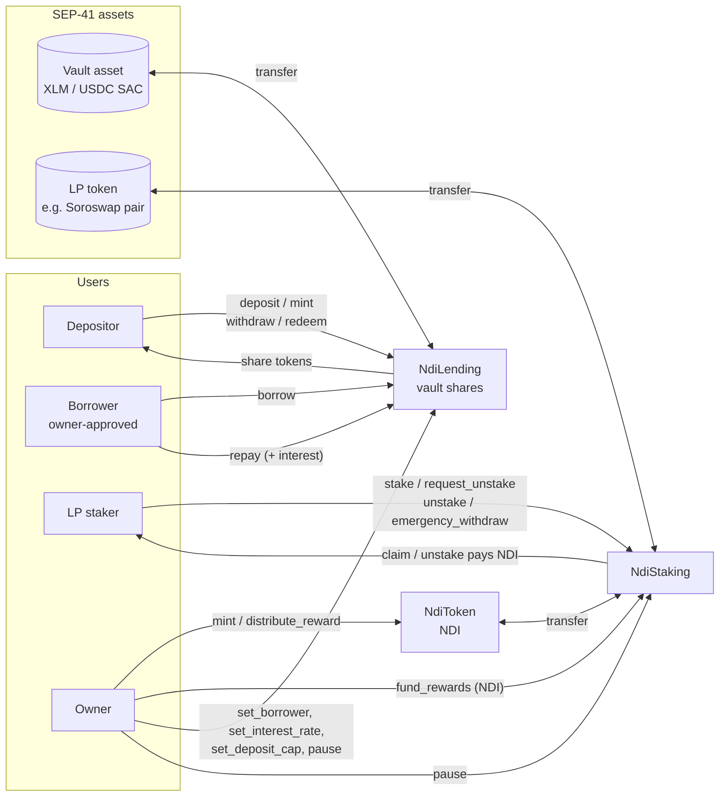
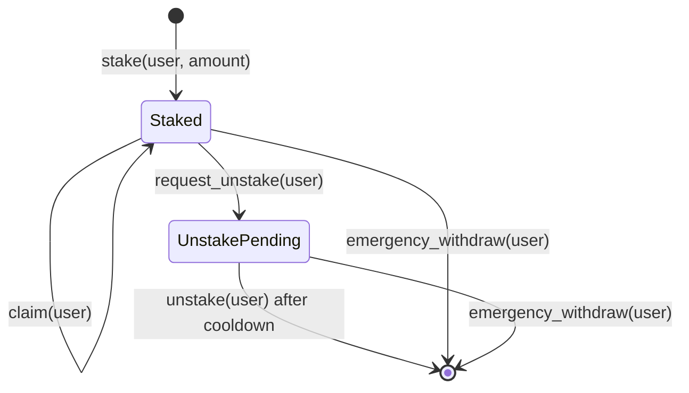
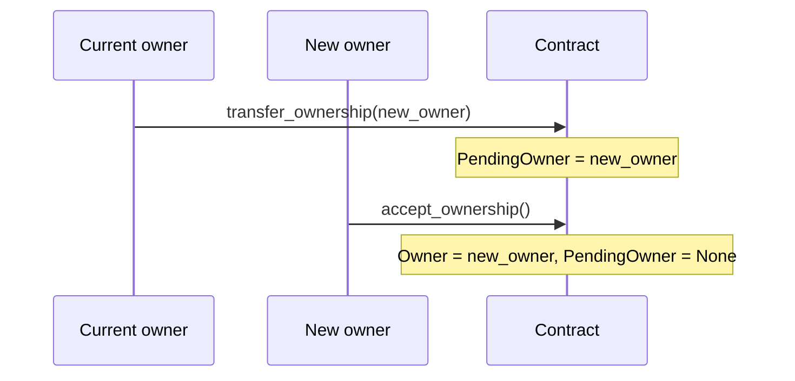
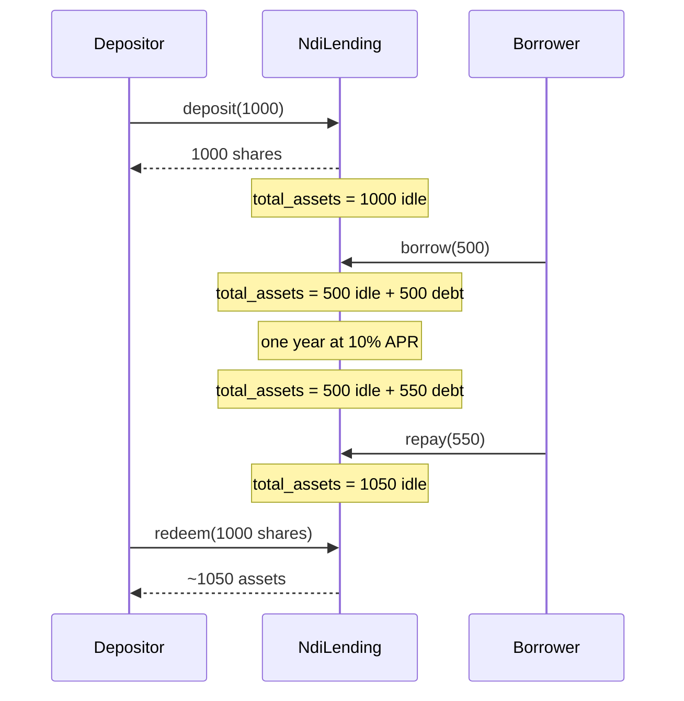

# Ndi-Fi on Stellar: architecture

Three independent Soroban contracts in `stellar/contracts/`. None of them calls
another Ndi-Fi contract directly; they interact only through SEP-41 token
transfers. This keeps each contract small and testable on its own.

| Contract | Crate | Role |
|---|---|---|
| `NdiToken` | `ndi_token` | SEP-41 reward/governance token (NDI). Capped at 1B, 7 decimals. |
| `NdiLending` | `ndi_lending` | Vault over a SEP-41 asset (XLM or USDC). Depositors get vault shares. One approved borrower draws liquidity at a fixed APR. |
| `NdiStaking` | `ndi_staking` | Users stake an LP token and earn NDI from a pre-funded reward pool. |

---

## Contract interactions



---

## Token contract (`ndi_token` / `NdiToken`)

### Design overview

`NdiToken` is a standard SEP-41 fungible token used for governance and reward
distribution. It maps from the Solidity `NdiPoint` / `NdiToken` contract and
layers the following OpenZeppelin Stellar modules:

| OZ module | Purpose |
|---|---|
| `FungibleToken` | `name`, `symbol`, `decimals`, `balance`, `allowance`, `transfer`, `transfer_from`, `approve` |
| `FungibleTotalSupply` | `total_supply` |
| `FungibleCapped` | `cap`, `remaining_supply`; enforced in `mint` |
| `FungibleBurnable` | `burn`, `burn_from` |
| `Ownable` (two-step) | `get_owner`, `transfer_ownership`, `accept_ownership`, `renounce_ownership` |
| `Pausable` | `pause`, `unpause`, `paused`; blocks transfers and burns when active |
| `Upgradeable` | `upgrade(new_wasm_hash, operator)` |

### Solidity mapping (`NdiPoint` → `ndi_token`)

| Solidity | Soroban | Notes |
|---|---|---|
| `constructor(initialOwner)` | `__constructor(owner)` | Mints 100 M NDI (`INITIAL_SUPPLY`) to `owner`. 7 decimals (not 18). |
| `name()` / `symbol()` / `decimals()` | `name` / `symbol` / `decimals` | OZ SEP-41 standard. |
| `mint(to, amount)` (MINTER_ROLE) | `mint(to, amount)` | Owner only. Cap enforced. |
| `distributeReward(recipient, amount, reason)` | `distribute_reward(recipient, amount, reason)` | Owner only; emits `RewardDistributed`. |
| `distributeRewards(recipients, amounts, reason)` | `distribute_rewards(recipients, amounts, reason)` | Owner only; all-or-nothing batch. |
| `lastRewardClaim(account)` | `last_reward_at(account)` | Records last distribution timestamp (not claim). |
| `maxSupply()` / `MAX_SUPPLY` | `max_supply` / `cap` | 1 000 000 000 NDI, 7 decimals = 10^16 raw units. |
| `remainingSupply()` | `remaining_supply` | `cap - total_supply`. |
| `pause()` / `unpause()` | `pause(caller)` / `unpause(caller)` | Owner only; OZ Pausable. |
| `recoverTokens(token, to, amount)` | `recover_tokens(token, to, amount)` | Owner only; rescues any SEP-41 token. |
| `grantRole` / `revokeRole` / `hasRole` | `get_owner` / `transfer_ownership` / … | Roles replaced by OZ Ownable. |
| `permit` (EIP-2612) | — | Not needed: Soroban auth framework. |
| `setContractAuthorization` | — | Dropped; flag was never read. |
| — | `upgrade(new_wasm_hash, operator)` | OZ Upgradeable, owner only. |

### Key design decisions

- **7 decimals** — Stellar convention; SAC assets use 7, so NDI matches.
- **No roles** — a single owner keeps the MVP simple. AccessControl via
  `stellar-access` can be added in a future wave.
- **Reward distribution vs. minting** — `distribute_reward` transfers from the
  owner's balance rather than minting, keeping total supply predictable.
- **Paused transfers** — `transfer`, `transfer_from`, `burn`, and `burn_from`
  all revert while paused. `mint` (owner-gated) is not blocked.

---

## Lending vault (`ndi_lending` / `NdiLending`)

### Design overview

`NdiLending` is an ERC-4626-style vault (OpenZeppelin `FungibleVault`) over any
SEP-41 asset. Depositors receive vault shares; one owner-approved borrower can
pull liquidity and repay it at a fixed APR.

| OZ module | Purpose |
|---|---|
| `FungibleVault` | Full EIP-4626 share mechanics, `deposit`/`mint`/`withdraw`/`redeem`, `convert_to_*`, `max_*`, `preview_*` |
| `Ownable` (two-step) | Same as NdiToken |
| `Pausable` | Blocks all vault operations except `repay` |
| `Upgradeable` | Same as NdiToken |

### Solidity mapping (`NdiFiVault` → `ndi_lending`)

| Solidity | Soroban | Notes |
|---|---|---|
| `constructor(daiToken, initialOwner)` | `__constructor(owner, asset, name, symbol, deposit_cap, interest_rate)` | Any SEP-41 asset. |
| `totalAssets()` | `total_assets` | **Idle balance + outstanding debt with accrued interest.** Solidity counts only the balance. |
| `deposit(amount, receiver)` | `deposit(assets, receiver, from, operator)` | Cap enforced. |
| `mint(shares, receiver)` | `mint(shares, receiver, from, operator)` | Cap enforced (Solidity did not). |
| `withdraw(assets, receiver, owner)` | `withdraw(assets, receiver, owner, operator)` | Respects idle liquidity. |
| `redeem(shares, receiver, owner)` | `redeem(shares, receiver, owner, operator)` | |
| `stakingCap` / `setStakingCap` | `deposit_cap` / `set_deposit_cap(cap)` | Owner only. |
| `pauseVault()` / `unpauseVault()` | `pause(caller)` / `unpause(caller)` | Also makes `max_*` return 0. |
| `emergencyWithdraw(to, _initialOwner)` | `emergency_withdraw(to)` | Owner only **and only while paused**. |
| `authorizedLendingContract` | `borrower` | Single approved address; cannot change while debt is outstanding. |
| `withdrawForLoan(to, amount)` | `borrow(amount)` | Borrower signs; debt is recorded with timestamp. |
| — | `repay(from, amount)` | Returns funds to vault and reduces debt. |
| — | `total_debt` / `interest_rate` / `set_interest_rate(rate)` | New fixed-rate interest model. |
| `getAvailableLiquidity()` | `available_liquidity` | |
| — | `utilization` | `total_debt / total_assets`. |

### Interest model (`interest.rs`)

Simple interest capitalised into the debt whenever debt is touched:

```
accrued = debt * rate * elapsed_seconds
          ─────────────────────────────
              1e7 * SECONDS_PER_YEAR
```

`rate` is scaled by 1e7 (`1_000_000` = 10% APR). `total_assets` and `total_debt`
include interest accrued up to the **current ledger time** even between touches,
so share price reflects reality at every moment.

### Deposit-cap enforcement

The cap is on `total_assets` (idle + debt), checked in both `deposit` and
`mint`. This closes the bypass present in the Solidity vault where `mint` was
uncapped.

### Pause semantics

| Operation | Paused | Notes |
|---|---|---|
| `deposit` / `mint` | ✗ blocked | |
| `withdraw` / `redeem` | ✗ blocked | |
| `borrow` | ✗ blocked | |
| `repay` | ✓ open | Borrowers can always reduce risk. |
| `emergency_withdraw` | ✓ only while paused | Owner sends idle assets to `to`. |
| `max_deposit` / `max_mint` / `max_withdraw` / `max_redeem` | Returns 0 | ERC-4626 vault spec. |

### Key design decisions

- **Debt counts in `total_assets`** — keeps the share price fair while funds
  are lent out. Depositors effectively earn the fixed APR on the borrowed
  portion.
- **Single borrower** — matches the MVP scope. A future collateral-loan contract
  would call `set_borrower` and become the single borrower, pulling liquidity
  as needed.
- **`repay` returns funds to vault** — unlike the Solidity `NdiFiLending` where
  repayments stayed in the lending contract and never returned to depositors.

---

## Staking contract (`ndi_staking` / `NdiStaking`)

### Design overview

`NdiStaking` lets users stake an LP token and earn NDI from a pre-funded reward
pool. It maps from `NdiFiStaking.sol` with the vault-routing bug removed.

| OZ module | Purpose |
|---|---|
| `Ownable` (two-step) | Owner gates config changes and pausing. |
| `Pausable` | Blocks `stake` and `request_unstake`. `emergency_withdraw` stays open. |
| `Upgradeable` | Same as other contracts. |

### Solidity mapping (`NdiFiStaking` → `ndi_staking`)

| Solidity | Soroban | Notes |
|---|---|---|
| `constructor(stakeToken, rewardToken, vault, owner, apy, minStake, maxStake, minDuration)` | `__constructor(owner, stake_token, reward_token, reward_rate, min_stake, max_stake, cooldown)` | No vault. `cooldown` replaces hard-coded 21-day wait. |
| `stake(amount)` | `stake(user, amount)` | Bounded by `min_stake` / `max_stake`. One open stake per user. |
| `pendingRewards(user)` | `pending_rewards(user)` | Same linear formula (see below). |
| `claimRewards()` | `claim(user)` | Transfers NDI from reward pool to user. |
| `requestWithdrawal()` | `request_unstake(user)` | Records timestamp; cooldown begins. |
| `executeWithdrawal()` | `unstake(user)` | Returns `(lp_amount, reward)`. Deletes stake record. |
| `stakes(user)` / `withdrawalRequests(user)` | `get_stake(user)` | Request merged into `StakeInfo.unstake_requested_at`. |
| `totalStaked` | `total_staked` | |
| — | `emergency_withdraw(user)` | Returns LP principal at any time; forfeits unclaimed rewards. |
| — | `fund_rewards(from, amount)` / `reward_pool` | Explicit NDI funding; stake ≠ reward token enforced. |
| `getProfits()` / `skimProfits(to)` | — | Dropped with vault routing. |
| `minDuration` | — | Dropped; was stored but never enforced in Solidity. |

### Reward formula

```
pending = staked_amount
          × reward_rate
          × elapsed_seconds
          ──────────────────────
          1e7 × SECONDS_PER_YEAR
        − rewards_claimed
```

`reward_rate` scaled by 1e7: `1_000_000` = 10% APY on the staked LP value
(denominated in LP tokens, not USD). Rewards keep accruing during the unstake
cooldown — matching Solidity behaviour, flagged as an open question for
maintainers.

### Staking lifecycle



### Key design decisions

- **LP token, not vault shares** — the stake token and reward token must
  differ, so the NDI reward pool cannot accidentally be drained as principal.
  This fixes the critical `executeWithdrawal` bug in Solidity where the first
  unstaker received every staker's principal.
- **`emergency_withdraw` always open** — principal is never stuck even if the
  reward pool is empty or NDI is paused.
- **Stake record deleted on exit** — saves persistent storage rent. `get_stake`
  returns `None` after unstake or emergency exit.
- **Cooldown is a constructor argument** — testable and configurable. The
  deploy script defaults to 21 days to match Solidity.

---

## Role model and access control

All three contracts share the same ownership model:

| Mechanism | Implementation |
|---|---|
| Single owner | OZ `Ownable` with two-step transfer (`transfer_ownership` → `accept_ownership`) |
| Owner renunciation | `renounce_ownership` permanently removes the owner |
| No role hierarchy | MVP simplicity; `stellar-access` AccessControl available for future waves |



Privileged operations per contract:

| Operation | NdiToken | NdiLending | NdiStaking |
|---|---|---|---|
| Pause / unpause | Owner | Owner | Owner |
| Mint | Owner | — | — |
| Set deposit cap | — | Owner | — |
| Set interest rate | — | Owner | — |
| Set / clear borrower | — | Owner | — |
| Fund rewards | — | — | Owner or any (permissionless fund) |
| Emergency withdraw | Owner | Owner (paused only) | Any user (own stake) |
| Upgrade | Owner | Owner | Owner |

---

## Upgrade paths

Each contract implements OZ `Upgradeable`:

```
owner calls upgrade(new_wasm_hash, operator)
  └─ Soroban host swaps the WASM in place
  └─ Storage layout is preserved
  └─ No proxy; no re-deployment of contract address
```

### Upgrade pre-flight checklist

1. **Storage layout audit** — any new persistent key must be additive; removing
   or retyping an existing key requires a migration plan (see `WAVE_ISSUES.md`).
2. **Schema version bump** — if the storage layout changes, increment the
   on-chain schema version key and add a migration function called on first
   post-upgrade interaction.
3. **Testnet dry-run** — deploy the new WASM to testnet, run the full test
   suite, and verify `get_owner`, `paused`, and a round-trip deposit/withdraw
   still work.
4. **Multi-sig approval** — recommend a multi-sig admin account on mainnet.
   See `WAVE_ISSUES.md` for the open governance question.
5. **Event replay** — verify that historical events decode correctly against the
   new ABI (no breaking changes to `#[contracttype]` structs).

The full upgrade procedure and key-management guidance live in
[`../../docs/UPGRADEABILITY.md`](../UPGRADEABILITY.md).

---

## Storage layout

### NdiToken

| Scope | Key | Type | TTL policy |
|---|---|---|---|
| Instance | `name`, `symbol`, `decimals` metadata | `String` / `u32` | Extended on every state-changing call |
| Instance | `cap` | `i128` | Extended on every state-changing call |
| Instance | `total_supply` | `i128` | Extended on every state-changing call |
| Instance | `owner`, `pending_owner` | `Address` / `Option<Address>` | Extended on every state-changing call |
| Instance | `paused` | `bool` | Extended on every state-changing call |
| Persistent | `Balance(address)`, `Allowance(address, address, ledger)` | `i128` | Extended on read and write (OZ: 30-day threshold, 90-day target) |
| Persistent | `LastRewardAt(address)` | `u64` (ledger timestamp) | Extended on write |

### NdiLending

| Scope | Key | Type | TTL policy |
|---|---|---|---|
| Instance | `asset` | `Address` | Extended on every mutation |
| Instance | `decimals_offset` | `u32` | Extended on every mutation |
| Instance | `deposit_cap` | `Option<i128>` | Extended on every mutation |
| Instance | `interest_rate` | `i128` (1e7-scaled) | Extended on every mutation |
| Instance | `borrower` | `Option<Address>` | Extended on every mutation |
| Instance | `debt_principal`, `debt_timestamp` | `i128`, `u64` | Updated on borrow/repay/rate change |
| Instance | `owner`, `pending_owner`, `paused` | as above | Extended on every mutation |
| Persistent | share `Balance`, `Allowance` | `i128` | OZ: 30-day / 90-day |

### NdiStaking

| Scope | Key | Type | TTL policy |
|---|---|---|---|
| Instance | `Config` (`stake_token`, `reward_token`, `reward_rate`, `min_stake`, `max_stake`, `cooldown`) | `Config` struct | Extended on every mutation |
| Instance | `total_staked` | `i128` | Extended on every mutation |
| Instance | `owner`, `pending_owner`, `paused` | as above | Extended on every mutation |
| Persistent | `Stake(address)` | `StakeInfo` struct | Extended on read and write (30-day / 90-day) |

> **TTL note:** every state-changing call extends the **instance** TTL (30-day
> threshold → 90-day target). Persistent entries owned by Ndi-Fi code are
> extended on read **and** write. OpenZeppelin manages the TTL of its own
> balance and allowance entries.

---

## Errors and events

Each contract has a `#[contracterror]` enum with codes below 100.
OpenZeppelin modules use their own ranges: fungible 100+, vault 400+,
pausable 1000+, fixed-point math 1500+, ownable 2100+.

### NdiToken

| Ndi-Fi event | Trigger |
|---|---|
| `RewardDistributed { recipient, amount, reason, timestamp }` | `distribute_reward` / `distribute_rewards` |
| `TokensRecovered { token, to, amount }` | `recover_tokens` |

OpenZeppelin emits: `Transfer`, `Approve`, `Mint`, `Burn`, `Paused`, `Unpaused`,
ownership transfer events.

### NdiLending

| Ndi-Fi event | Trigger |
|---|---|
| `Borrowed { borrower, amount, timestamp }` | `borrow` |
| `Repaid { from, amount, interest_paid, remaining_debt, timestamp }` | `repay` |
| `BorrowerUpdated { borrower }` | `set_borrower` |
| `DepositCapUpdated { cap }` | `set_deposit_cap` |
| `InterestRateUpdated { rate }` | `set_interest_rate` |
| `EmergencyWithdrawn { to, amount }` | `emergency_withdraw` |

OpenZeppelin emits: `Deposit`, `Withdraw`, share `Transfer`/`Approve`,
`Paused`, `Unpaused`, ownership events.

### NdiStaking

| Ndi-Fi event | Trigger |
|---|---|
| `Staked { user, amount, timestamp }` | `stake` |
| `RewardClaimed { user, amount, timestamp }` | `claim` |
| `UnstakeRequested { user, available_at }` | `request_unstake` |
| `Unstaked { user, amount, reward, timestamp }` | `unstake` |
| `EmergencyWithdrawn { user, amount, timestamp }` | `emergency_withdraw` |
| `RewardsFunded { from, amount, new_pool_balance }` | `fund_rewards` |

OpenZeppelin emits: `Paused`, `Unpaused`, ownership events.

---

## Diagrams

### Lending: deposit → borrow → repay → withdraw



### Staking: stake → claim → request unstake → unstake

```mermaid
sequenceDiagram
    participant U as User
    participant K as NdiStaking
    participant T as NdiToken (NDI)

    U->>K: stake(500 LP)
    Note over K: StakeInfo recorded; cooldown timer not started

    U->>K: claim(user)
    K->>T: transfer(reward, user)
    Note over U: NDI rewards received

    U->>K: request_unstake(user)
    Note over K: StakeInfo.unstake_requested_at = now

    Note over K: cooldown (default 21 days) elapses

    U->>K: unstake(user)
    K-->>U: 500 LP + final NDI reward
    Note over K: Stake record deleted
```

---

## Cross-links

- [`MIGRATION.md`](./MIGRATION.md) — full Solidity → Soroban function mapping,
  deviations, Solidity bugs noted, and future oracle work.
- [`WAVE_ISSUES.md`](./WAVE_ISSUES.md) — open issues and next-wave design
  questions (oracle integration, multi-sig governance, role extensions).
- [`../../docs/UPGRADEABILITY.md`](../UPGRADEABILITY.md) — upgrade procedure,
  verification steps, and key management.
- [`../../docs/ORACLE.md`](../ORACLE.md) — Ethereum-side oracle configuration
  and the planned Reflector (SEP-40) integration.
