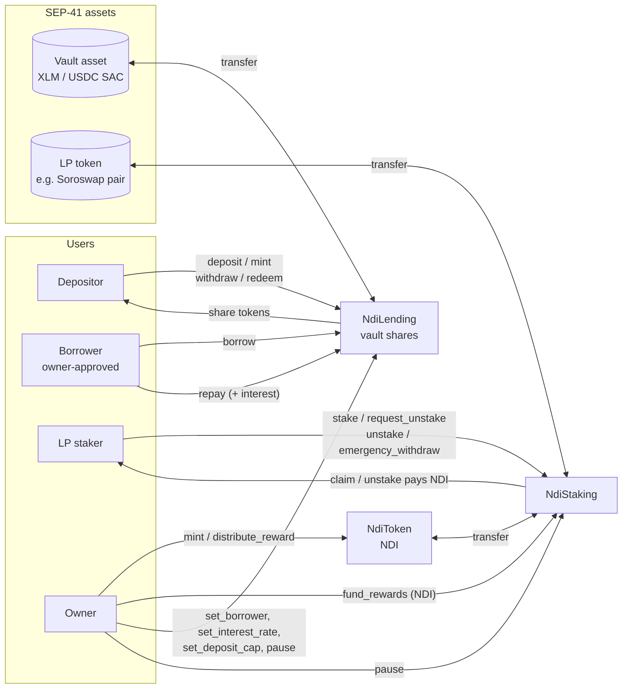
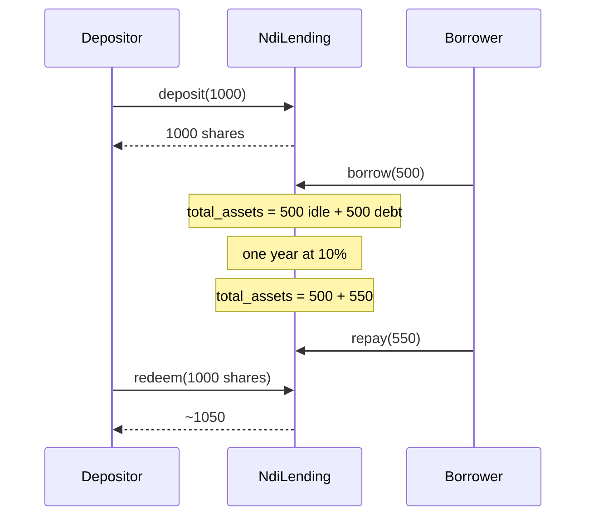

# Ndi-Fi on Stellar: architecture

Three independent Soroban contracts in `stellar/contracts/`. None of them calls
another Ndi-Fi contract directly; they interact only through SEP-41 token
transfers. This keeps each contract small and testable on its own.

| Contract | Crate | Role |
|---|---|---|
| `NdiToken` | `ndi_token` | SEP-41 reward/governance token (NDI). Capped at 1B, 7 decimals. |
| `NdiLending` | `ndi_lending` | Vault over a SEP-41 asset (XLM or USDC). Depositors get vault shares. One approved borrower draws liquidity at a fixed APR. |
| `NdiStaking` | `ndi_staking` | Users stake an LP token and earn NDI from a pre-funded reward pool. |

## Contract interactions

## Lending vault

- Built on the OpenZeppelin Stellar `FungibleVault`. Share accounting, allowances, and the `Deposit`/`Withdraw` events come from OpenZeppelin.
- `total_assets = idle balance + outstanding debt (with interest)`. NdiLending overrides the conversion functions so lent-out funds keep counting toward the share price. Deposits and withdrawals still use OpenZeppelin's internal `deposit_internal` / `withdraw_internal`.
- Interest (`interest.rs`): annual rate scaled by 1e7 (`1_000_000` = 10%). Simple interest is capitalised into the debt whenever `borrow`, `repay` or `set_interest_rate` runs. Views (`total_debt`, `total_assets`) include interest accrued up to the current ledger time.
- Withdrawals are limited by idle liquidity. If most funds are lent out, `max_withdraw` falls and `withdraw` returns `InsufficientLiquidity` until the borrower repays.
- Pause blocks deposit, mint, withdraw, redeem and borrow. `repay` stays open. `emergency_withdraw` (owner) works only while paused.

## Staking

- One open stake per user, between `min_stake` and `max_stake`.
- Rewards are linear: `amount * reward_rate * elapsed / (1e7 * 365 days) - rewards_claimed`.
- Unstaking has two steps: `request_unstake`, then `unstake` after `cooldown` seconds. Rewards keep accruing during the cooldown, as in the Solidity version.
- `emergency_withdraw` returns the LP tokens at any time, including while paused, and forfeits unclaimed rewards.
- The stake token and reward token must differ, so the reward pool is just the contract's NDI balance.

## Storage layout

| Contract | Instance (config, small) | Persistent (per user) |
|---|---|---|
| NdiToken | metadata, cap, total supply, owner, paused | balances, allowances (OZ), `LastRewardAt(user)` |
| NdiLending | asset, decimals offset, cap, rate, borrower, debt, owner, paused | share balances and allowances (OZ) |
| NdiStaking | `Config`, total staked, owner, paused | `Stake(user)` |

Every state-changing call extends the instance TTL. Persistent entries owned by
Ndi-Fi code are extended on read and write (30-day threshold, 90-day target).
OpenZeppelin extends its own balance entries.

## Errors and events

Each contract has a `#[contracterror]` enum with codes below 100.
OpenZeppelin modules use their own ranges: fungible 100+, vault 400+,
pausable 1000+, fixed-point math 1500+, ownable 2100+.

| Contract | Events emitted by Ndi-Fi code | Events from OpenZeppelin |
|---|---|---|
| NdiToken | `RewardDistributed`, `TokensRecovered` | `Transfer`, `Approve`, `Mint`, `Burn`, `Paused`, `Unpaused`, ownership events |
| NdiLending | `Borrowed`, `Repaid`, `BorrowerUpdated`, `DepositCapUpdated`, `InterestRateUpdated`, `EmergencyWithdrawn` | `Deposit`, `Withdraw`, share `Transfer`/`Approve`, `Paused`, `Unpaused`, ownership events |
| NdiStaking | `Staked`, `RewardClaimed`, `UnstakeRequested`, `Unstaked`, `EmergencyWithdrawn`, `RewardsFunded` | `Paused`, `Unpaused`, ownership events |

## Upgrades

Each contract implements OpenZeppelin `Upgradeable`: the owner uploads new WASM
and calls `upgrade(new_wasm_hash, operator)`. Storage is kept. There are no
proxies. Any change to storage layout needs a migration plan (see
`WAVE_ISSUES.md`).
